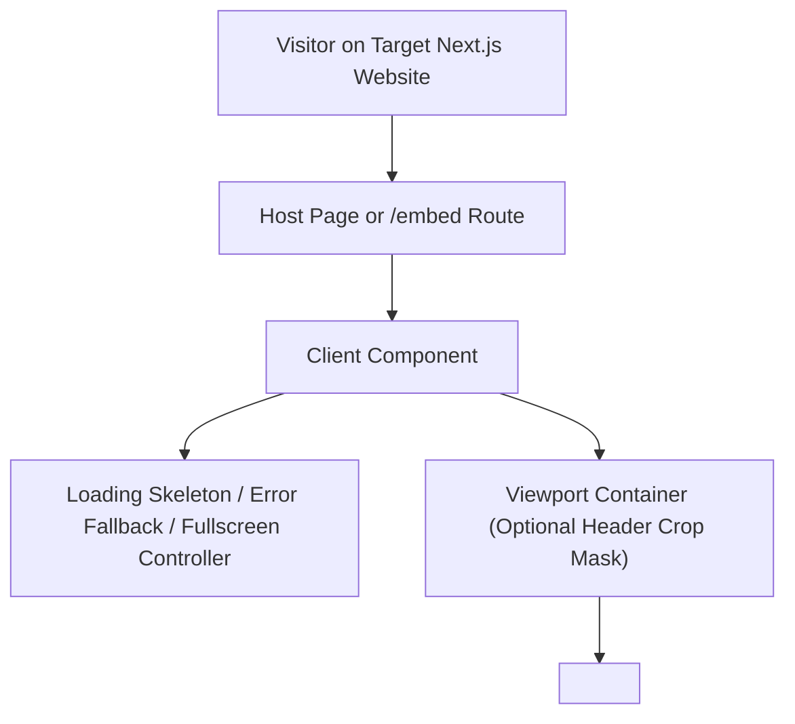

# Knowledge Graph `<iframe>` Embed Implementation Plan (For Target Next.js Frontend)

## 1. Overview and Objective

This document provides a standardized, self-contained implementation plan for embedding the deployed **LLM Wiki Knowledge Graph** into another Next.js frontend project using an `<iframe>` and a dedicated `/embed` route.

- **Deployed Graph Endpoint**: `https://wiki-graph.tay-shon-da1.workers.dev/graph`
- **Supported Deep-Link Query Parameter**: `?note=<url-encoded-node-id>` (e.g., `https://wiki-graph.tay-shon-da1.workers.dev/graph?note=index`)

This guide makes no assumptions about internal components or file paths of the graph service itself and is written entirely from the perspective of the **consuming (host) Next.js application**.

---

## 2. Architecture in the Target Next.js Project



### Key Capabilities of the Host Integration
1. **Declarative Deep-Linking**: Pass a `note` identifier (or URL search parameter) to automatically focus and center a specific topic in the embedded graph.
2. **Canvas-Only Header Masking (`cropHeader` Mode)**: The remote `/graph` page renders a `56px` (`3.5rem`) top navigation header. The host wrapper component supports an optional `cropHeader` flag that shifts and clips the top `56px` of the iframe so only the interactive graph canvas is visible.
3. **Loading & Offline Resilience**: Displays a themed loading state until the iframe triggers `onLoad`, with a timeout fallback and direct external link if the network blocks framing.
4. **Native Fullscreen & Host Controls**: Uses the browser Fullscreen API (`Element.requestFullscreen()`) on the wrapper container so users can expand the embedded graph to full screen from any page.

---

## 3. Step-by-Step Implementation Guide

### Step 1: Environment Variable Configuration

In the target Next.js project, define the remote graph URL in `.env.local` (and your deployment environment):

```env
# .env.local
NEXT_PUBLIC_WIKI_GRAPH_URL=https://wiki-graph.tay-shon-da1.workers.dev/graph
```

---

### Step 2: Content Security Policy (`next.config.ts`)

If your target Next.js application defines a strict `Content-Security-Policy` header, allow `https://wiki-graph.tay-shon-da1.workers.dev` in the `frame-src` directive:

```ts
// next.config.ts
import type { NextConfig } from 'next';

const nextConfig: NextConfig = {
  async headers() {
    return [
      {
        source: '/:path*',
        headers: [
          {
            key: 'Content-Security-Policy',
            value:
              "frame-src 'self' https://wiki-graph.tay-shon-da1.workers.dev;",
          },
        ],
      },
    ];
  },
};

export default nextConfig;
```

---

### Step 3: Define Standardized Embed Types

Create a type contract file for the embed component props, URL parameters, and optional cross-window `postMessage` events:

```ts
// types/graph-embed.ts

export interface GraphEmbedOptions {
  /** Base URL of the deployed graph page. Defaults to NEXT_PUBLIC_WIKI_GRAPH_URL. */
  baseUrl?: string;
  /** Optional node ID to select and focus on initial load (maps to ?note=...). */
  note?: string | null;
  /** Additional custom query parameters to forward to the iframe URL. */
  queryParams?: Record<string, string | number | boolean | undefined>;
  /** Visually crops out the top 56px navigation bar of the remote page to show only the canvas. */
  cropHeader?: boolean;
  /** Height of the embed container (e.g. '600px', '80vh', '100%'). Defaults to '640px'. */
  height?: string;
  /** Optional CSS class names for the outer wrapper container. */
  className?: string;
  /** Show host overlay controls (Fullscreen toggle, Reload, Open in new tab). Defaults to true. */
  showHostControls?: boolean;
  /** Accessible title for the iframe element. */
  title?: string;
  /** Callback fired when the iframe finishes loading. */
  onLoad?: () => void;
}

export interface GraphPostMessageEvent {
  type: string;
  payload?: Record<string, unknown>;
}
```

---

### Step 4: Build the Reusable `<GraphEmbed />` Client Component

Create the reusable client component that renders the `<iframe>`, manages loading and fullscreen states, and constructs the target URL.

```tsx
// components/GraphEmbed.tsx
'use client';

import React, {
  useState,
  useMemo,
  useRef,
  useEffect,
  useCallback,
} from 'react';
import type { GraphEmbedOptions } from '../types/graph-embed';

const DEFAULT_GRAPH_URL =
  process.env.NEXT_PUBLIC_WIKI_GRAPH_URL ||
  'https://wiki-graph.tay-shon-da1.workers.dev/graph';

// Height of the remote graph application's top navigation bar (3.5rem / 56px)
const REMOTE_HEADER_HEIGHT_PX = 56;

export function GraphEmbed({
  baseUrl = DEFAULT_GRAPH_URL,
  note = null,
  queryParams,
  cropHeader = false,
  height = '640px',
  className = '',
  showHostControls = true,
  title = 'Interactive Knowledge Graph',
  onLoad,
}: GraphEmbedOptions) {
  const containerRef = useRef<HTMLDivElement>(null);
  const iframeRef = useRef<HTMLIFrameElement>(null);

  const [isLoaded, setIsLoaded] = useState(false);
  const [isTimedOut, setIsTimedOut] = useState(false);
  const [isFullscreen, setIsFullscreen] = useState(false);
  const [reloadKey, setReloadKey] = useState(0);

  // 1. Construct the full iframe URL with query parameters
  const iframeSrc = useMemo(() => {
    const url = new URL(baseUrl);

    if (note && note.trim()) {
      url.searchParams.set('note', note.trim());
    }

    if (queryParams) {
      Object.entries(queryParams).forEach(([key, value]) => {
        if (value !== undefined && value !== null && value !== '') {
          url.searchParams.set(key, String(value));
        }
      });
    }

    return url.toString();
  }, [baseUrl, note, queryParams]);

  // 2. Reset loading state when URL or reloadKey changes
  useEffect(() => {
    setIsLoaded(false);
    setIsTimedOut(false);

    const timer = window.setTimeout(() => {
      setIsTimedOut((prev) => (!isLoaded ? true : prev));
    }, 15000);

    return () => window.clearTimeout(timer);
  }, [iframeSrc, reloadKey]);

  // 3. Synchronize Fullscreen state with browser events
  useEffect(() => {
    const handleFullscreenChange = () => {
      setIsFullscreen(Boolean(document.fullscreenElement));
    };

    document.addEventListener('fullscreenchange', handleFullscreenChange);
    return () =>
      document.removeEventListener('fullscreenchange', handleFullscreenChange);
  }, []);

  // 4. Handlers for load, reload, and fullscreen toggle
  const handleIframeLoad = useCallback(() => {
    setIsLoaded(true);
    setIsTimedOut(false);
    onLoad?.();
  }, [onLoad]);

  const handleReload = useCallback(() => {
    setReloadKey((prev) => prev + 1);
  }, []);

  const handleToggleFullscreen = useCallback(async () => {
    if (!containerRef.current) return;
    try {
      if (!document.fullscreenElement) {
        await containerRef.current.requestFullscreen();
      } else {
        await document.exitFullscreen();
      }
    } catch (err) {
      console.warn('Fullscreen toggle failed:', err);
    }
  }, []);

  return (
    <div
      ref={containerRef}
      style={{ height: isFullscreen ? '100vh' : height }}
      className={`relative w-full overflow-hidden rounded-2xl border border-slate-800 bg-[#060b18] shadow-2xl ${className}`}
    >
      {/* Loading Overlay */}
      {!isLoaded && (
        <div className="absolute inset-0 z-20 flex flex-col items-center justify-center bg-[#060b18] text-slate-200">
          <div className="h-8 w-8 animate-spin rounded-full border-2 border-cyan-400 border-t-transparent" />
          <p className="mt-3 text-sm font-medium text-cyan-200">
            Loading interactive knowledge graph...
          </p>

          {isTimedOut && (
            <div className="mt-4 flex flex-col items-center gap-2 text-center">
              <p className="text-xs text-slate-400">
                Taking longer than expected to reach the graph service.
              </p>
              <div className="flex items-center gap-2">
                <button
                  type="button"
                  onClick={handleReload}
                  className="rounded-lg bg-cyan-500/20 px-3 py-1.5 text-xs font-medium text-cyan-300 border border-cyan-500/40 hover:bg-cyan-500/30 transition"
                >
                  Retry
                </button>
                <a
                  href={iframeSrc}
                  target="_blank"
                  rel="noopener noreferrer"
                  className="rounded-lg bg-slate-800 px-3 py-1.5 text-xs font-medium text-slate-200 hover:bg-slate-700 transition"
                >
                  Open Directly ↗
                </a>
              </div>
            </div>
          )}
        </div>
      )}

      {/* Host Action Controls (Top-Right Overlay) */}
      {showHostControls && (
        <div className="absolute bottom-4 left-1/2 -translate-x-1/2 z-30 flex items-center gap-1.5 rounded-xl border border-slate-800/80 bg-slate-950/80 px-2.5 py-1.5 text-xs text-slate-300 backdrop-blur-md shadow-lg">
          <button
            type="button"
            onClick={handleReload}
            className="rounded-lg px-2 py-1 hover:bg-slate-800 hover:text-white transition"
            title="Reload Graph"
          >
            Reload
          </button>
          <span className="text-slate-700">|</span>
          <button
            type="button"
            onClick={handleToggleFullscreen}
            className="rounded-lg px-2 py-1 hover:bg-slate-800 hover:text-white transition"
            title="Toggle Fullscreen"
          >
            {isFullscreen ? 'Exit Fullscreen' : 'Fullscreen'}
          </button>
          <span className="text-slate-700">|</span>
          <a
            href={iframeSrc}
            target="_blank"
            rel="noopener noreferrer"
            className="rounded-lg px-2 py-1 hover:bg-slate-800 hover:text-white transition"
            title="Open full graph in a new tab"
          >
            Open ↗
          </a>
        </div>
      )}

      {/* Iframe Viewport (Supports optional top header cropping) */}
      <div
        style={
          cropHeader
            ? {
                marginTop: `-${REMOTE_HEADER_HEIGHT_PX}px`,
                height: `calc(100% + ${REMOTE_HEADER_HEIGHT_PX}px)`,
              }
            : { height: '100%' }
        }
        className="w-full"
      >
        <iframe
          key={reloadKey}
          ref={iframeRef}
          src={iframeSrc}
          title={title}
          onLoad={handleIframeLoad}
          className="h-full w-full border-0 block"
          loading="lazy"
          allow="fullscreen; clipboard-read; clipboard-write"
          referrerPolicy="no-referrer-when-downgrade"
        />
      </div>
    </div>
  );
}
```

---

### Step 5: Create the Dedicated `/embed` Route (`app/embed/page.tsx`)

In the target Next.js application, create `app/embed/page.tsx` to serve a full-viewport embeddable page or standalone graph viewer route that forwards URL query parameters (`?note=...`, `?cropHeader=true`, `?controls=false`) to `<GraphEmbed />`:

```tsx
// app/embed/page.tsx
import React from 'react';
import { GraphEmbed } from '../../components/GraphEmbed';

interface EmbedPageProps {
  searchParams: Promise<{ [key: string]: string | string[] | undefined }>;
}

export default async function EmbedPage({ searchParams }: EmbedPageProps) {
  const resolvedParams = await searchParams;

  const note =
    typeof resolvedParams.note === 'string' ? resolvedParams.note : null;
  const cropHeader = resolvedParams.cropHeader === 'true';
  const showControls = resolvedParams.controls !== 'false';

  return (
    <main className="w-screen h-screen overflow-hidden bg-[#060b18]">
      <GraphEmbed
        note={note}
        cropHeader={cropHeader}
        showHostControls={showControls}
        height="100vh"
        className="rounded-none border-0"
      />
    </main>
  );
}
```

---

### Step 6: Embedding Inside Any Existing Page or Article

In addition to the full-screen `/embed` route, any page in the target Next.js project can embed the graph inline:

```tsx
// Example usage in any page of the target Next.js project
import { GraphEmbed } from '@/components/GraphEmbed';

export default function DocumentationGraphSection() {
  return (
    <section className="mx-auto max-w-6xl py-8 px-4">
      <h2 className="text-2xl font-bold text-white mb-4">
        Explore the Knowledge Graph
      </h2>
      <GraphEmbed
        note="index"
        cropHeader={true}
        height="680px"
      />
    </section>
  );
}
```

---

## 4. URL Parameter Reference for `/embed` on the Target Site

| Parameter | Values | Default | Behavior |
| :--- | :--- | :--- | :--- |
| `note` | `string` (e.g. `index`) | `undefined` | Forwards `?note=<value>` to `https://wiki-graph.tay-shon-da1.workers.dev/graph?note=<value>` to focus that node on load. |
| `cropHeader` | `'true' \| 'false'` | `'false'` | When `'true'`, masks the top `56px` navigation bar of the remote page for a pure canvas look. |
| `controls` | `'true' \| 'false'` | `'true'` | Shows or hides the host floating action bar (`Reload`, `Fullscreen`, `Open ↗`). |

---

## 5. Verification Checklist

1. **Iframe URL Construction**:
   - Verify `<GraphEmbed note="index" />` renders an `<iframe>` with `src="https://wiki-graph.tay-shon-da1.workers.dev/graph?note=index"`.
2. **Canvas-Only Header Masking**:
   - Verify `<GraphEmbed cropHeader={true} />` offsets the inner wrapper by `-56px` and expands height by `calc(100% + 56px)`, hiding the remote header while keeping the bottom-left and bottom-right canvas controls intact.
3. **Loading & Fullscreen Behavior**:
   - Verify the loading spinner disappears once the iframe `onLoad` event fires.
   - Verify clicking `Fullscreen` expands the graph container to `100vh`.
